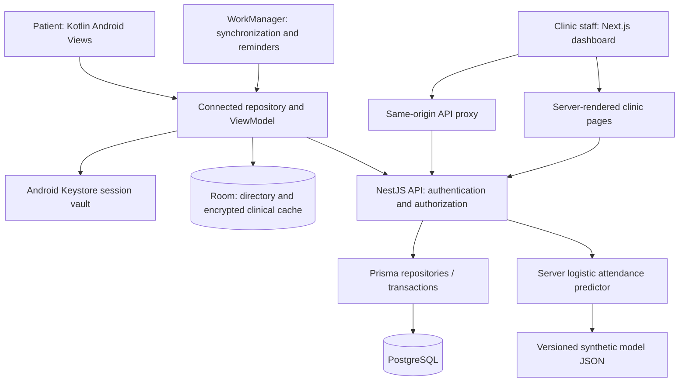
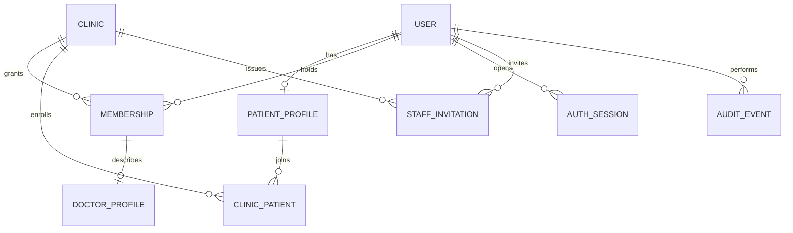
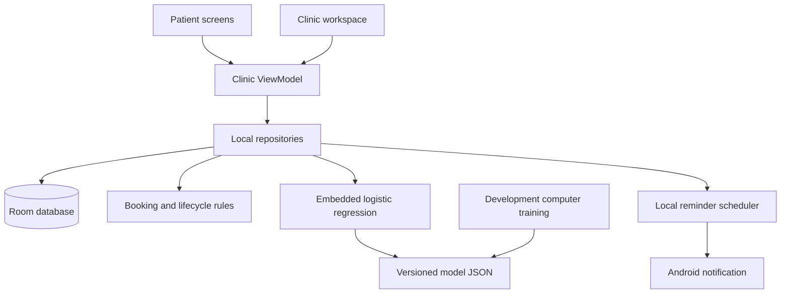
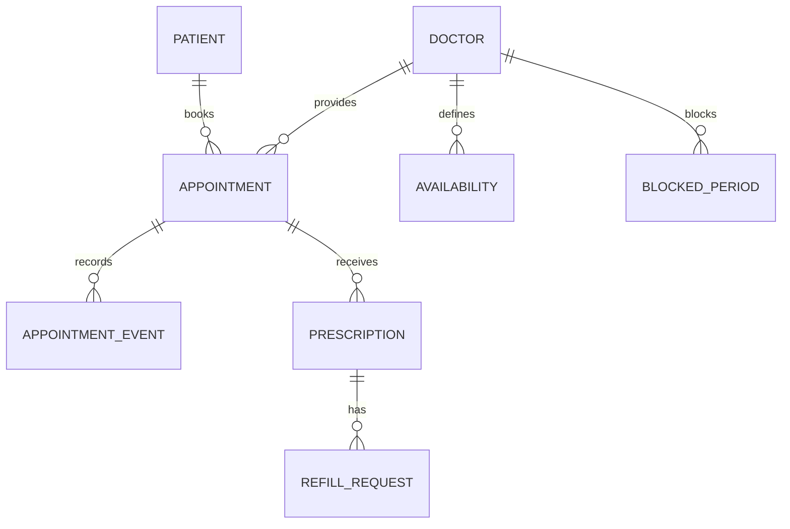

# CareSlot architecture

## Shared application architecture

The 1.5.1 development build supports trusted same-Wi-Fi access: the phone uses the computer's selected private IPv4 address on port 3001, with no ADB reverse requirement. The API requires explicit LAN opt-in and rejects requests received through other computer interface addresses. A named Private-profile firewall rule permits only the API on the Wi-Fi interface/local subnet. The dashboard remains on loopback; PostgreSQL configuration is unchanged. The selected debug host alone receives an HTTP exception; release remains HTTPS-only. This supersedes the USB-only transport statements in the historical account/reminder slice below. See `docs/LOCAL_OPERATIONS.md` and `qa/shared/wifi-sync/report.json`.

The first shared implementation connects individual patient and clinic staff accounts to one API and PostgreSQL database. The Android app serves patients. The web dashboard serves clinic administrators, receptionists, and doctors. An administrator is a user with a clinic membership; the server itself is a running service, not a person or shared login.

### Current responsibilities

- **Android:** patient signup/login, shared booking/visit/care workflows, profile/password/session controls, read-only offline clinical copies and opt-in appointment reminders. Access/refresh credentials and clinical payloads use a non-exportable Android Keystore key. Room cache entries belong to a stable user ID; logout removes that account's cache and reminder work. Connected WorkManager synchronization is approximately every 15 minutes; reminder delivery revalidates the visit through the API. Slots and all writes require a live connection.
- **Next.js:** staff login, clinic overview/directory, role-scoped visit management and care, patient registrations, invitations/access management, verified recovery-code issuance and account controls. Server-rendered pages fetch through the API. Browser writes use the same-origin proxy, session cookie, and CSRF header. The web code never queries PostgreSQL directly.
- **NestJS:** validates request DTOs, hashes passwords using Argon2id, issues sessions, enforces role and clinic ownership, executes transactional writes, and records relevant audit events. A public patient signup cannot assign staff roles. Doctor and receptionist accounts are created through an administrator invitation.
- **PostgreSQL:** authoritative identities, memberships, patient-to-clinic enrollment, doctor directory, invitations, sessions, and audit records. Runtime credentials have data access; schema migrations use a separate owner credential. Stable UUIDs determine ownership.

Mobile access tokens expire after 15 minutes. Refresh credentials rotate, are stored hashed on the server, and have a fixed 30-day session expiry. Protected requests check the current session and account state in PostgreSQL. Web sessions use opaque HttpOnly cookies with an eight-hour expiry; unsafe requests require the configured origin and a CSRF token. HTTPS and secure cookies are required for production configuration.

The initial clinic is deliberately a single configured clinic (`careslot`). Its onboarding uses the local setup/seed flow; self-service onboarding and a multi-clinic selector are not implemented. An accepted invitation can add a staff membership to an existing account only after its current password is verified. Invitation links expire after seven days; only their hashes are stored. Delivery is manual in this release. The versioned sections below document subsequent account, appointment, care and synchronization responsibilities.

### Care tools and document ownership (1.6.0)

`ExperienceService` owns professional/health profile edits, consultation summaries, prescription corrections, private document grants, per-user inboxes, medication plans and authorized exports. It uses the existing authenticated actor and appointment/prescribing scopes. Administrator/reception scheduling access does not grant clinical prescription, summary or patient-document access.

The additive migration adds `VisitSummary`, `HealthDocument`, `DocumentGrant`, `InboxNotice`, `MedicationPlan` and `DoseLog`. Prescription issue/replacement freezes issuer, clinic, patient and medicine details in `issuedSnapshot`; status remains current for download and verification. A replacement links to the previous document and keeps its history. Summaries are private drafts until the assigned doctor issues them for an attended visit.

Uploaded bytes remain in PostgreSQL with patient ownership, file metadata/hash and quotas. A grant links a document to its specific appointment/doctor, expiry and revocation state; each download rechecks these and the visit status. Exports perform authorization before generating bytes. Anonymous high-entropy QR references reveal minimal issuer/status information, with no patient identity or medication details.

Android `ExperienceActivity` provides live patient care tools and explicit system file/calendar/share handoffs. `MedicationReminders` stores scheduled work identities locally, while the server owns the patient-confirmed medicine/times/date/version data and dose logs. WorkManager verifies that the prescription is still current before posting a generic notification. Logout clears account work and private export cache. Existing Room clinical copies remain dated and read-only; new clinical writes are never queued offline.

### Shared identity relationships

The initial schema is versioned under `apps/api/prisma/migrations/`. `care-connected.db` is a disposable, account-scoped Android directory cache. The earlier `care-clinic.db` remains separate and is not copied into PostgreSQL automatically.

The authoritative `careslot` database runs in the existing PostgreSQL Windows service on `127.0.0.1:5432`, outside the project directory. Moving the source folder on this computer does not move or reset that database. `.env` supplies runtime and migration connections; source-relative resolution keeps the API, Prisma, and dashboard configuration portable. `.local/` holds private development files and a fresh backup of the active PostgreSQL service database. The retired cluster was stopped after the service transfer; its data files were not carried over when the source folder moved to `C:\project\smart medical appointment app`. The service migration compared all public tables by row count and content hash before switching connections and stopping that old cluster. The transfer preserves identities, passwords, sessions, and migration history; it does not upload the Android offline demo's separate clinical records.

### Implementation sequence

| Stage | Deliverable | Current status / acceptance |
| --- | --- | --- |
| 1. Shared identity and directory | Database, patient app login, staff dashboard login, clinic roles, invitations, patient registration list, cached doctor directory | Implemented; user confirmed shared patient registration and doctor visibility; remaining acceptance checks pending |
| 2. Accounts, synchronization and reminders | Profile/password changes, verified recovery codes, session and staff-access revocation, clinical cache, durable request identities and reminder lifecycle | First combined slice implemented; acceptance and limits recorded in qa/shared/accounts-sync/report.json; multi-clinic onboarding deferred |
| 3. Availability and appointments | Server-owned schedules, slot generation, conflict validation, atomic booking/rescheduling/cancellation, schedule history and staff queue | Implemented shared booking/lifecycle slice; primary-agent phone and browser checks recorded separately |
| 4. Visit care | Clinician attendance, patient/doctor ownership, prescriptions and refill review, audit history | Prescriptions/refills plus 1.6.0 document identity, corrections/revocation and issued consultation summaries implemented; pharmacy integration deferred |
| 5. Merged into stage 2 | Synchronization and reminders are delivered with account administration | See combined stage 2 |
| 6. Prediction and scheduling | Server logistic regression using authoritative attendance inputs; immutable booking snapshots, normal scheduling fallback, explicit simulation controls | Implemented in 1.5.0; live capacity stays standard, experimental overbooking is simulation only; see qa/shared/prediction/report.json |
| 7. Local operational readiness | Managed local startup/recovery, verified backup/restore, secret/configuration checks, dependency/auth review and acceptance | Focused automated, browser and direct phone checks PASS; 19-table restore drill PASS; public deployment deferred by user; human usability/full TalkBack remain pending. See qa/shared/local-readiness/report.json. |

Each stage includes UI loading/empty/error states, relevant compile checks, and a manual checklist for the user. At the user's updated request, the primary agent performs physical-device testing on each completed mobile pass. No testing subagents are used. User acceptance remains separate; a compiled build does not establish acceptance.

### Combined account, synchronization and reminder slice (1.4.0)

This section supersedes the earlier slice-specific statements about directory-only caching and in-memory retry identities. Android Room version 2 uses an additive migration: the original directory table remains, while `clinical_cache` has a composite `(userId, kind)` primary key. Clinical responses and booking/refill request identities are encrypted with the session vault's non-exportable Android Keystore AES-GCM key. Only the most recent first page of upcoming visits, past visits and care is cached. Transport/service failures may fall back to that account's dated read-only copy; authorization failures do not. Logout/account switching/detected revocation delete account caches and reminder work. Slots and all writes require the live server; there is no offline write queue. Existing server unique constraints and appointment versions remain authoritative.

Name updates are self-scoped. Password changes lock the user row, verify the current password and revoke all sessions/recovery codes in one transaction. Login session creation takes the same lock and checks the verified password hash again to prevent an old-password login racing a reset. Other-session revocation leaves the actor's current session active. Clinic staff access changes lock the clinic, require a web administrator, block self-removal and retain clinical history. Removing access revokes web sessions; protected requests recheck active membership.

`AccountRecovery` stores only a code hash, target user, issuing administrator, verification note, expiry and consumption time. Codes expire after 30 minutes, are replaced on reissue and consumed atomically under the user lock. Recovery is restricted to active patients/non-admin staff in the issuing clinic. Administrator recovery is a trusted local operator script with hidden password input, never a public endpoint. Fictional email addresses require no mail service. The app remains one configured clinic; the existing setup/seed process is its onboarding path. Email changes and self-service tenant onboarding are deferred.

WorkManager refreshes connected account/clinical data approximately every 15 minutes under a network constraint. Per-visit reminder names include the account, visit UUID and version. Reconciliation removes obsolete work and posted notifications, and enqueues one-time work roughly 24 hours before a future booked visit. Delivery revalidates the live list/version/status and current signed-in account, checks permission/opt-in, then posts generic private notification text. A local delivered ledger prevents repeat delivery for the same version; logout removes the ledger and work. Android persists WorkManager work across restart, but battery restrictions and force-stop affect delivery. A connected desktop API/USB forwarding is required in this development configuration; this is not a push-notification deployment.

### Availability slice (1.1.0)

`WorkingDay` stores one local-time interval per doctor/weekday. `BlockedPeriod` stores absolute UTC boundaries and a staff-only reason. All boundaries use the clinic's IANA time zone, with round-trip checks for nonexistent daylight-saving times. Patient requests are restricted to enrolled clinics, active doctors and dates from today through 90 days ahead. Times are generated in whole consultation increments from that day's opening time; partial or elapsed consultations and every blocked overlap are excluded.

Schedule writes lock the doctor row within a PostgreSQL transaction and require the last observed `scheduleVersion`; an outdated edit returns 409. Blocks also increment that version. Doctors edit only their own profile, admins edit clinic profiles, and reception has read-only access. Database constraints enforce unique weekdays and valid interval boundaries. Staff actions create audit events. Existing identity data is preserved by the additive `20261025_availability` migration.

The subsequent appointment slice below adds reservations using the same doctor lock. A displayed time is never a guarantee of a confirmed visit. Multiple daily sessions and clinic onboarding remain unimplemented.

### Shared appointment slice (1.2.0)

`Appointment` stores stable clinic/doctor/patient IDs, UTC start/end, a time-zone snapshot, status, optimistic version, schedule-review flag, and the original booking request identity/time. `AppointmentEvent` records confirmations, rescheduling with old/new boundaries, cancellation, attendance and schedule-review changes. Foreign keys preserve ownership and history; the additive `20261025_appointments` migration changes no existing accounts or working hours.

The server acquires doctor then patient row locks in every appointment mutation. It rechecks enrollment, active doctor membership, exact slot alignment, working hours, blocks, doctor capacity and cross-doctor patient overlap inside the transaction. This serializes competing requests without trusting the time displayed on the phone. The unique patient/request key returns the current result for a replay of the same booking; reusing it with a different payload fails. Rescheduling keeps the appointment ID and changes its schedule plus history atomically. Optimistic versions reject stale cancellation/rescheduling/status writes. Failed transactions preserve the existing appointment.

Schedule edits hold that same doctor lock, keep existing confirmed intervals unchanged and recompute `needsReview`. They increment appointment versions and record review events only when the flag changes. Cancelled, attended and missed appointments are terminal; attendance requires the visit to have started and missed status requires its end to have passed. Patients cannot cancel or reschedule a visit after it starts.

Patient routes require the authenticated mobile patient and never accept a caller-supplied patient ID. Staff routes require a clinic web membership; doctors are restricted to their own appointments. Both clients read/write through the API. Appointment lists and available times require a live connection in this slice; Room remains only a directory cache. No offline booking queue, automatic reminders, overbooking, staff-created reservations, cross-doctor rescheduling or prediction inputs are implemented yet. Booking request identities currently persist in ViewModel memory; process-death/network uncertainty is resolved by checking the authoritative visit list.

Server-side booking and prediction are authoritative in the connected version. No patient-supplied probability or feature can authorize capacity. The 1.5.0 slice below implements server inference and a separate simulation; a real clinic overbooking policy remains deferred until there is validated evidence and an explicit operational decision.

### Server prediction and simulation slice (1.5.0)

The API loads `apps/api/models/attendance_model.json` once at startup and checks the feature/class/scaling contract. Booking and rescheduling run the retained logistic model inside their existing doctor/patient locking transaction. `AttendanceSnapshot` saves appointment/version/start, as-of time, model version/fingerprint, normalized-input source values, selected outcome IDs and no-show probability. Rescheduling creates a new snapshot; replay/cancellation do not overwrite prior ones. Model loading/inference failure produces an unavailable snapshot while standard booking remains usable. Existing visits are not backfilled.

Historical inputs are clinic/patient scoped: latest 20 attended/missed appointments whose ends and recorded outcome events precede prediction time. New-patient smoothing is `(missed+1)/(completed+4)`. Lead days use clinic calendar dates and are capped at the trained maximum of 60; raw values/clamping are retained for 90-day bookings. The reminder feature is false because the server cannot verify mobile eligibility/delivery. DTO validation rejects client probabilities/features. Model training stays on the development computer; connected mobile screens only render server snapshots, including dated encrypted offline copies. The Kotlin predictor asset remains reference material and has no connected-screen caller.

Queue responses show clinic staff snapshot provenance/counts; patient responses omit feature counts and selected history IDs. Model version/SHA-256 and as-of time identify the exact estimate. This is experimental synthetic-data inference, not a clinical judgement or validated attendance model.

The web Scheduling simulation screen is available to active web administrators/doctors in their clinic. It runs bounded seed-based paired synthetic scenarios without reading patient features or writing reservations. Standard scheduling is the default. An explicit comparison toggle enables at most two bookings per slot and combined expected attendance at most 1.2. Both policies share candidate demand, attendance draws and service durations. Outputs include unused capacity, collisions, waiting and overtime means. Missing models disable assisted simulation but keep the standard comparison available. Every live slot still admits only one patient; server locks and overlap checks are unchanged.

`docs/MODEL_CARD.md` records model/evaluation assumptions. `evaluation/server-results.json` evaluates the deployed reminder=false policy against independent synthetic records; `qa/shared/prediction/simulation.json` is a distinct high-missed-history stress scenario, so their distributions and measures must not be presented as real clinic outcomes.

### Shared prescription slice (1.3.0)

`Prescription` anchors immutable clinician-issued instructions to the attended appointment, patient, clinic and assigned doctor. `PrescriptionMedicine` stores ordered text fields for medicine, dose, frequency, duration and instructions. `RefillRequest` records the patient note, pending/final status, optimistic version, reviewing clinician, decision note/time and optional issued renewal. The original prescription and all rejected/approved request history remain unchanged when a linked renewal is issued.

Only web doctors can access the clinical workspace, and only their assigned visits qualify. Admin/reception roles have no prescription/refill permissions. Patient requests use the authenticated mobile patient ID; caller-supplied medication or ownership fields are rejected. New requests require an active enrolled clinic/doctor. Historical documents remain readable by their owner if the doctor becomes inactive.

Issue transactions lock the appointment row, require attended status and reject duplicate initial documents. Refill transactions lock the source prescription, prevent duplicate pending requests and reject changes to reviewed versions. Approval creates the new prescription/medicine set and final review atomically; rejection creates no medicine document. Request identities make retries safe while a confirmation remains in client memory. SQL partial unique indexes additionally enforce one initial prescription per visit and one pending refill per prescription; a unique renewal link prevents branching renewals. Keep these custom constraints in migrations rather than replacing the schema with an unreviewed database push.

The additive `20261025_prescriptions` migration preserves previous identities, schedules and visits. Clinical lists require the live service; Room/WorkManager still cache only account-scoped directory information. Patient care is paginated; the doctor's workspace shows the latest 50 issued documents/eligible visits, the first 50 waiting requests and 20 recent decisions. An attended-visit link can load that visit's documents directly. This slice has no prescribing automation, dose calculations, dispensing, clinical correction/withdrawal, or automatic course-expiry policy.

## Historical offline demonstration

The earlier prototype source is archived under `legacy/android-demo/`, outside the active app build. Its patient and clinic personas shared one local database; its profile switch was not a server authentication boundary. The APK now exposes only the connected patient experience. Legacy activities, receivers and QA instrumentation are removed; one-time upgrade cleanup cancels demo reminder metadata and its notification channel without opening or deleting legacy clinical databases. The embedded model interface remains in the active app. The diagrams below describe historical reference code.

## Boundaries

- UI components display state and collect input. ViewModels retain screen state and execute work away from the UI thread.
- Repositories own record identity, persistence, ownership filtering, validation, and atomic appointment changes.
- The prediction interface separates model inference from booking. A failed model disables simulation, not ordinary booking.
- Reminder scheduling uses appointment identity, reschedules after changes, and rechecks current record state before posting.
- Clinical text is manually entered in the clinic persona. The app does not generate medication decisions.

## Data relationships

Records use stable IDs, not display-name matching. Existing JSON records are imported once with deterministic identities and legacy care-plan preservation. Database queries and mutations run on a serial worker to prevent conflicting local changes.

## Earlier test boundaries

The earlier phase reports under `qa/phase-XX/` describe the offline demonstration only. Their checks do not validate the new shared service. The shared release records build/provisioning evidence separately and leaves functional acceptance to the user. Human usability observations require human participants.
